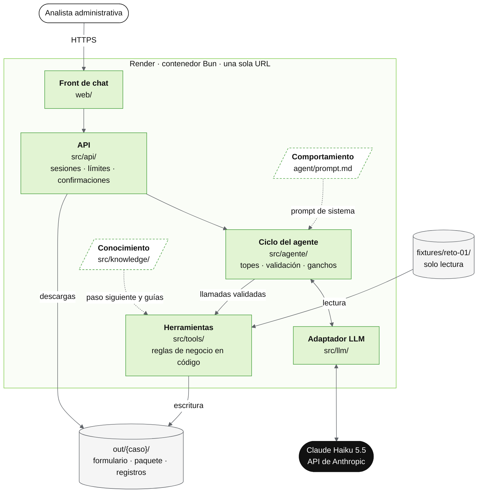
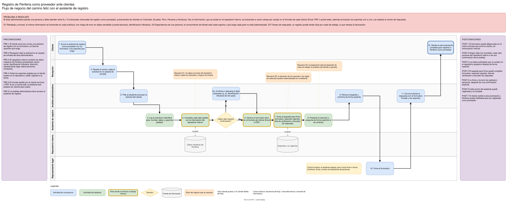
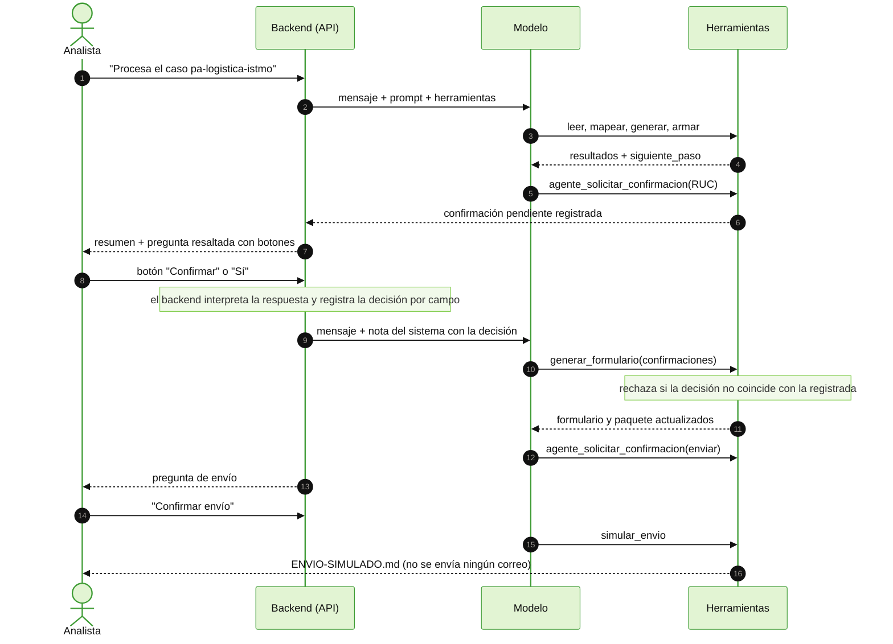

# SOLUCION: Agente "Registro como Proveedor"

> Estructura según PRD §9.1. Referencias: `HU-NN` y `CA-NN.MM` en `docs/HISTORIAS-USUARIO.md`; `DEC-NN` en `docs/DECISIONES.md`. La sección se indica entre paréntesis, por ejemplo: DEC-28 (DECISIONES §5.7).

## 1. Problema en una frase

El área administrativa de Periferia recibe por correo solicitudes de registro como proveedor con datos que ya existen en su repositorio interno. Consolidar, aprobar y enviar esa información es un proceso lineal y con pocas variantes, pero se hace a mano: queda sujeto al error humano y a una eficiencia operativa reducida por la carga de trabajo de la analista.

## 2. Arquitectura



| Capa | Dónde vive | Qué contiene |
|---|---|---|
| Comportamiento | `agent/prompt.md` | Rol, reglas no negociables, "happy path" y formato de respuesta. |
| Conocimiento | `src/knowledge/` | Reglas por país y vigencias (`reglas.ts`, `registro-proveedor.md`), tabla del flujo (`flujo.ts`) y guías por variante (`variantes/`). |
| Ejecución | `src/tools/` | Las cinco herramientas del contrato y la de confirmación. Toda regla de negocio se cumple aquí, en código. |
| Orquestación | `src/agente/`, `src/llm/` | Ciclo con topes, validación de argumentos y adaptador intercambiable de proveedor. |
| Interfaz | `web/`, `src/api/` | Chat, llamadas visibles, confirmación con botones, descargas e indicadores de consumo. |

Principio de diseño: **el código decide y el modelo orquesta.** Cada resultado de herramienta indica el paso siguiente y, solo cuando aplica, la guía de la variante, de modo que un modelo pequeño no necesita cargar todas las reglas: DEC-28 (DECISIONES §5.7).

API: `GET /api/health`, `POST /api/chat`, `GET /api/sessions/:id`, `GET /api/files/:caso[/ruta]` (detalle en `README.md`).

**Dependencias**

| Dependencia | Uso | Por qué |
|---|---|---|
| `zod` | Argumentos de las herramientas y variables de entorno | Obligatoria según el PRD; además genera el esquema JSON que ve el modelo. |
| `@anthropic-ai/sdk` | Implementación del adaptador para Claude | SDK oficial, con errores tipados y herramientas en modo estricto. |
| `exceljs` | Formulario Excel | Escribe celdas como texto (conserva ceros a la izquierda), con relleno y notas: DEC-14 (DECISIONES §5.4). |
| `pdf-lib` | Formulario PDF | Genera el PDF sin dependencias nativas. |
| `typescript`, `@types/bun` (desarrollo) | Revisión de tipos | Bun ejecuta TypeScript sin verificar tipos; `bun run typecheck` lo hace. |

El servidor HTTP, la carga de `.env` y las pruebas usan Bun, sin dependencias adicionales. El front no tiene dependencias.

## 3. Ciclo del agente

### Flujo de negocio

Camino feliz del registro como proveedor con el asistente: actores, actividades, puntos de confirmación de la analista, precondiciones y postcondiciones.

[](docs/diagramas/flujo-registro-proveedor.svg)

Clic en la imagen para verla en tamaño completo.

### Ciclo por mensaje

Implementado en `src/agente/ciclo.ts`. Por cada mensaje de la analista:

1. El modelo recibe el historial, el prompt de sistema y las herramientas con esquemas estrictos.
2. Cada llamada a herramienta se valida con zod antes de ejecutarse; una llamada idéntica sin cambio de estado se rechaza: DEC-28 (DECISIONES §5.7).
3. El resultado vuelve al modelo con el paso siguiente. El ciclo repite hasta una respuesta final, una solicitud de confirmación o un tope.

| Tope | Valor | Al alcanzarlo | Referencia |
|---|---|---|---|
| Iteraciones por mensaje | 25 | Responde con lo completado y lo pendiente, sin otra llamada al modelo | PRD CA1; CA-17.04 (HISTORIAS §6.6) |
| Tokens por sesión | 400 000 | Aviso para abrir una sesión nueva | PRD §8; DEC-21 (DECISIONES §5.6) |
| Espera al proveedor | 60 s | Mensaje claro; la sesión sigue activa | CA-14.04 (HISTORIAS §6.5) |
| Peticiones por origen | 20 por minuto | Rechazo temporal con aviso | DEC-18 (DECISIONES §5.5) |

### Confirmación humana

El modelo no decide qué confirmó la analista; lo decide el backend:

- La única forma de pedir una confirmación es la herramienta `agente_solicitar_confirmacion`: DEC-24 (DECISIONES §5.7).
- El backend interpreta la respuesta (botón o lista cerrada de expresiones) y registra la decisión por campo; la herramienta rechaza cualquier decisión distinta: DEC-25 (DECISIONES §5.7).
- La confirmación vale solo para el turno siguiente, y la de campos nunca se combina con la de envío: DEC-06 (DECISIONES §5.2); CA-06.07 (HISTORIAS §6.2).
- "Enviar" solo escribe `out/<caso>/ENVIO-SIMULADO.md`: DEC-10 (DECISIONES §5.3).



## 4. Elección del modelo

**Anthropic Claude Haiku 5.5** (`claude-haiku-5-5`), con esfuerzo de razonamiento `low`, mediante el SDK oficial de TypeScript: DEC-21 (DECISIONES §5.6).

**Requisitos excluyentes:** llamado a herramientas en conversaciones de varios turnos, acceso por API desde Render (sin GPU) y clave solo en variable de entorno del backend.

**Factores de decisión**, con prioridad del equipo en costo e integración: costo por caso y del proyecto (35 %), integración con TypeScript, Bun y zod (25 %), fiabilidad del llamado a herramientas (20 %), alta de cuenta y control de gasto (10 %), límites de uso durante la defensa (5 %) y tratamiento de los datos enviados (5 %). Matriz completa: DEC-21 (DECISIONES §5.6) y DECISIONES §8.2.

| Alternativa | Puntaje (sobre 5) | Motivo |
|---|---|---|
| **Claude Haiku 5.5** | **4,70** | Elegido: menor costo entre los modelos de pago con precio verificado, SDK con herramientas definidas en zod. |
| Modelo pequeño de OpenAI | 4,35 | Integración comparable, pero mayor costo y precio no verificado. |
| Gemini Flash, capa gratuita | 4,05 | Costo cero, pero límites de uso variables y datos usados para mejorar el producto. |
| Claude Sonnet 5.5 | 3,85 | Más capaz, unas 15 veces el costo sin necesidad demostrada. Queda como escalamiento. |

**Costo medido** con el link público y en local (tarifa USD 0,10 de entrada y 0,50 de salida por millón de tokens):

| Escenario | Costo |
|---|---|
| Caso completo en un mensaje (Colombia: 5 herramientas, listo para firma) | USD 0,003 |
| Caso con confirmación de campo y envío (Panamá: 3 mensajes) | USD 0,009 |
| Volumen mensual del PRD (8 a 12 casos) | Menos de USD 0,15 |

Cada consulta ronda los 30 000 tokens de entrada. La estimación no descuenta la lectura de caché, así que el costo real es igual o menor.

**Escalamiento:** cambiar `LLM_MODEL` a `claude-sonnet-5-5` no requiere tocar código (unos USD 0,15 por caso estimados); cambiar de proveedor requiere solo otra implementación del adaptador en `src/llm/`.

## 5. Diseño del portal web

Algunos clientes no piden un Excel ni un PDF, sino que el registro se haga en su propio portal de proveedores, con un usuario y una contraseña que Periferia ya tiene; en el caso de prueba `pa-logistica-istmo` es el portal VendorHub, que pertenece al cliente Logística del Istmo. Como supuesto, se toma que estos portales se administran fuera de la infraestructura de Periferia, de modo que modificar su estructura o su comportamiento no se contempla como alternativa en este análisis: cualquier solución debe trabajar con el portal tal como el cliente lo ofrece. En la implementación actual ese escenario se resuelve de forma acotada: la herramienta informa que el formato no está soportado y genera `out/<caso>/valores-portal.md`, con cada campo, su valor y su estado, para que la analista lo copie a mano (DEC-07, DECISIONES §5.2; CA-09.01 a CA-09.05, HISTORIAS §6.3). Esta evaluación contrasta tres alternativas para llevar esos datos consolidados al portal del cliente y busca la más viable para la analista que hace el registro. En el texto, **Abby** es el nombre que el equipo le dio al agente desarrollado en esta prueba.

**Criterios de diseño.** Las tres alternativas se evaluaron contra los mismos criterios:

1. Toda acción automática sobre el portal debe poder monitorearse y auditarse igual que una acción humana.
2. El modelo no debe ver el portal ni las credenciales. El portal pertenece al cliente: no podemos limitar qué información muestra ni intervenir su seguridad.
3. El ingreso de credenciales y el clic en "Enviar" son humanos: PRD §7.4; RN4 (PRD §7.3).
4. El costo de la solución debe guardar proporción con el volumen: entre 8 y 12 solicitudes al mes (PRD §1).

### Escenario 1: Abby controla el navegador

Es la alternativa más automática. Una vez preparados los valores, Abby abre el portal en el equipo de la analista, un gestor de contraseñas inserta las credenciales sin mostrárselas, y el agente lee la página para decidir dónde escribir cada valor. La analista solo revisa al final y envía.

El problema aparece al mirar qué ve el agente y en nombre de quién actúa. Para ubicar los campos, el modelo tendría que leer todo lo que el portal muestre, y como el portal no es nuestro, no hay forma de restringir esa información. El acceso se hace con las credenciales de la analista, así que todo lo que el agente haga queda registrado a nombre de una persona que no lo hizo. Además, el agente y la analista compartirían la misma máquina, con el riesgo de que sus acciones choquen, y el funcionamiento quedaría sujeto a la actividad de ese equipo. Por último, el contenido del portal es texto externo que el modelo leería: una instrucción escondida en la página podría desviarlo, el mismo riesgo que cubren las pruebas con casos alterados (`docs/PRUEBAS.md`). Aunque las credenciales nunca pasen por el prompt, esta alternativa no cumple los criterios 1 y 2, y se descarta.

```
[Analista] Pide procesar el caso
  -> [Abby] Prepara los valores
  -> [Abby] Abre el portal en el equipo de la analista
  -> [Gestor de contraseñas] Inserta las credenciales sin mostrarlas
  -> [Abby] Lee la página y decide dónde escribir
  -> [Analista] Revisa y envía
```

### Escenario 2: RPA con acceso aprobado por MFA

Un robot de RPA resuelve buena parte de lo que falla en el escenario anterior. Abby prepara los valores y se los entrega estructurados; el robot inicia sesión con una cuenta técnica propia, guardada en una bóveda de credenciales, y llena el formulario con un guion fijo. Sus acciones son predecibles, repetibles y quedan registradas una por una, y al usar una cuenta propia lo que hace no se atribuye a la analista. El control humano se mantiene en dos puntos: el portal pide un MFA que la analista debe aprobar para que el robot entre, y el robot se detiene antes de enviar para que ella revise, apruebe o pida cambios.

La dificultad está en lo que hay que construir y mantener para sostenerlo. La cuenta técnica depende de que el cliente la emita, cosa que Periferia no controla. A eso se suman la bóveda, el control del MFA, una plataforma RPA y un guion por cada portal, que hay que actualizar cada vez que un cliente cambie su formulario. Si aparece un CAPTCHA, el robot se detiene; y asegurar que ningún componente automático intente resolverlo exige diseño y pruebas propias. Para 8 a 12 solicitudes al mes, ese costo no se justifica (criterio 4), y la alternativa se descarta. Se volvería a evaluar si Periferia ya contara con una plataforma RPA o si creciera el volumen de registros en portales.

```
[Analista] Pide en el chat procesar el caso
  -> [Abby] Lee, mapea, genera los valores y arma el paquete
  -> [Analista] Confirma los campos dudosos
  -> [Abby] Entrega los valores estructurados al RPA
  -> [RPA] Inicia sesión en el portal con una cuenta técnica guardada en una bóveda
  -> [Portal] Envía una solicitud de MFA
  -> [Analista] Aprueba el acceso
  -> [RPA] Llena el formulario con su guion fijo, sube los soportes y registra cada acción
  -> [RPA] Se detiene antes de enviar y avisa a la analista
  -> [Analista] Revisa el formulario y aprueba o pide cambios
  -> [Analista] Hace clic en "Enviar", o lo autoriza y el RPA lo ejecuta
```

```
Si el portal cambió o aparece un CAPTCHA:
[RPA] Falla y avisa
  -> [Analista] Completa a mano con valores-portal.md
  -> [Equipo técnico] Actualiza el guion del robot
```

### Escenario 3: extensión del navegador

La tercera alternativa deja a Abby tal como funciona hoy y agrega una pieza pequeña en el navegador de la analista. Abby procesa el caso, pide confirmación de los campos dudosos con el mecanismo que ya existe (DEC-24 y DEC-25, DECISIONES §5.7) y entrega los valores. La analista abre el portal e inicia sesión con su propio gestor de contraseñas; si el portal pide CAPTCHA o MFA, los resuelve ella como parte de su sesión normal, sin que haya que diseñar nada para eso. Con la sesión abierta, un clic en la extensión copia de una sola vez los valores listos en sus campos y deja marcados, sin llenar, los que están por confirmar o faltan. La analista completa lo marcado, adjunta los soportes, revisa y envía.

En este escenario el modelo nunca ve el portal: quien llena los campos es código fijo, con el mapeo de los campos de cada portal. Las credenciales siguen siendo un paso humano que no requiere construir ni guardar nada. Todas las acciones en el portal las hace la analista y quedan a su nombre, que es lo correcto; la extensión solo deja un registro local de qué campos llenó, con su valor y la hora. Si un cliente cambia su formulario, la extensión avisa qué campos no encontró y la analista los copia de `valores-portal.md`, que sigue siendo el respaldo. La contracara es que el registro depende de que la analista tenga tiempo de abrir el portal, pero eso ocurre en cualquier alternativa que respete el criterio 3; lo que cambia es cuánto le toma, y aquí se reduce a iniciar sesión, un clic, revisar y enviar. El único costo nuevo es mantener el mapeo de campos de cada portal, bastante menor que el de un robot.

```
[Analista] Pide en el chat procesar el caso
  -> [Abby] Lee la solicitud, mapea los campos, genera los valores y arma el paquete
  -> [Abby] Pide confirmación de los campos dudosos (DEC-24 y DEC-25)
  -> [Analista] Confirma o corrige
  -> [Abby] Entrega valores-portal.md y una versión estructurada para la extensión
  -> [Analista] Abre el portal del cliente
  -> [Analista] Inicia sesión con su gestor de contraseñas y resuelve el CAPTCHA o el MFA si el portal los pide
  -> [Analista] Hace clic en "Llenar" en la extensión
  -> [Extensión] Copia los valores listos en sus campos y marca los "por confirmar" y los faltantes, sin llenarlos
  -> [Analista] Revisa el formulario, completa lo marcado y adjunta los soportes del paquete
  -> [Analista] Hace clic en "Enviar" en el portal
```

```
Si la extensión no encuentra un campo porque el portal cambió:
[Extensión] Avisa qué campos no pudo llenar
  -> [Analista] Los copia de valores-portal.md
```

### Decisión

Se mantiene la extensión del navegador. Es la única alternativa que cumple los cuatro criterios a la vez: lo que ocurre en el portal lo hace y lo firma la analista, el modelo no ve el portal ni las credenciales, el ingreso y el envío siguen siendo humanos, y no exige más controles de seguridad ni automatizaciones que las que Abby ya tiene. Abby controlando el navegador se descarta por confidencialidad y atribución, y el RPA, aunque sólido en control y trazabilidad, tiene un costo de implementación y mantenimiento que el volumen actual no justifica. Este análisis complementa el riesgo de PRD §10 sobre portales con CAPTCHA o MFA y la sección 10 de este documento.

## 6. Decisiones y trade-offs

Registro completo con su trazabilidad al PRD: `docs/DECISIONES.md` (29 decisiones). Las de mayor impacto:

| # | Decisión | Alternativa descartada y por qué | Referencia |
|---|---|---|---|
| 1 | **El código decide y el modelo orquesta:** cada resultado de herramienta trae el paso siguiente y, solo si aplica, la guía de su variante. | Un prompt extenso con todas las reglas: contexto grande y más errores de un modelo pequeño. Una máquina de estados que oculta herramientas: más rígida, con control similar. | DEC-28 (DECISIONES §5.7) |
| 2 | **Mapeo determinista** por glosario y similitud de palabras, sin modelo. | Que el modelo proponga mapeos: más cobertura, pero sin trazabilidad ni resultados repetibles. | DEC-08 (DECISIONES §5.3) |
| 3 | **Los valores se releen del maestro**; el modelo solo aporta las confirmaciones de la analista. | Escribir los valores que envía el modelo: viola la regla de no afirmar datos fuera de las herramientas (PRD CA2). | DEC-04 (DECISIONES §5.2) |
| 4 | **La confirmación la registra el backend**, con una herramienta de control y la decisión por campo; el modelo no puede invertirla. | Confiar en el prompt o en la interpretación del modelo: en pruebas, una pregunta escrita solo en el texto no avanzaba el flujo, y una respuesta mal interpretada podía aceptar lo que la analista rechazó. | DEC-06 (DECISIONES §5.2); DEC-24, DEC-25 (DECISIONES §5.7) |
| 5 | **Un campo por confirmar bloquea la firma y se resuelve en el chat** antes de generar el documento. | Marcar el campo en el documento para revisión humana: obliga a revisar, corregir y volver a cargar, que es el reproceso a eliminar. | DEC-09 (DECISIONES §5.3) |
| 6 | **El envío simulado solo exige confirmación explícita**, aunque el paquete no esté listo; el agente advierte los motivos antes. | Rechazar el envío si el paquete no está listo: contradice el resultado esperado de PRD §11 para `ec-corp-andina`. | DEC-10 (DECISIONES §5.3) |
| 7 | **Se mapea siempre la plantilla completa**, aunque el modelo envíe una lista parcial. | Mapear solo lo que pide el modelo: una omisión suya dejaría el formulario incompleto. | DEC-22 (DECISIONES §5.7) |
| 8 | **Contenedor con proceso persistente en Render** y una sola URL para front y API. | Plataformas sin servidor: sin estado entre peticiones y sistema de archivos efímero, incompatibles con sesiones en memoria y `out/`. | DEC-18 (DECISIONES §5.5) |

**Trade-offs asumidos**

| Se gana | Se cede | Mitigación | Referencia |
|---|---|---|---|
| Costo por caso de USD 0,003 a 0,009 con Claude Haiku 5.5 | Margen de razonamiento frente a modelos mayores | Las reglas críticas están en código; escalamiento a Sonnet 5.5 sin cambiar código | DEC-21 (DECISIONES §5.6) |
| Sencillez: sesiones en memoria, sin base de datos | Las sesiones y `out/` se pierden al reiniciar el servicio | Aceptado por PRD §3.2; el front abre una sesión nueva sin error | DEC-27 (DECISIONES §5.7) |
| Costo cero de alojamiento | La capa gratuita suspende la instancia tras 15 minutos sin tráfico; el primer acceso tarda cerca de un minuto | Activar la instancia antes de la defensa; plan pago como opción | DEC-18 (DECISIONES §5.5) |
| Flexibilidad del lenguaje natural para pedir y preguntar | Ambigüedad en las respuestas de la analista | Las decisiones de riesgo se toman con botones o con una lista cerrada de expresiones | DEC-25 (DECISIONES §5.7) |

## 7. Supuestos

| Supuesto | Consecuencia en la solución | Referencia |
|---|---|---|
| Los fixtures se diseñaron para la fecha de versión del PRD (2026-09-03). | La vigencia de los soportes se evalúa contra `FECHA_REFERENCIA`, configurable; vacía usa la fecha del sistema. La demo usa 2026-09-03 si no hay variable. | DEC-02 (DECISIONES §5.1); DEC-23 (DECISIONES §5.7) |
| "Enviar" es responder al cliente con el paquete. | El envío es simulado: solo se escribe `ENVIO-SIMULADO.md`, con el estado del paquete y la condición de firma. | DEC-10 (DECISIONES §5.3) |
| Un campo por confirmar no puede firmarse sin decisión de la analista. | Bloquea el estado `listo_para_firma` hasta que se acepte o descarte. | DEC-09 (DECISIONES §5.3) |
| `soportes-exigidos.json` es la fuente de verdad de los soportes; el cuerpo del correo es contexto. | No se deducen soportes del texto libre. | DEC-12 (DECISIONES §5.3) |
| El repositorio no registra la fecha de expedición de los soportes. | La antigüedad máxima de la Cámara de Comercio que exige un cliente se informa como advertencia, no como bloqueo. | DEC-11 (DECISIONES §5.3) |
| Los soportes de Periferia se emiten en Colombia. | Para clientes de otros países se advierte verificar su aceptación o apostilla. | DEC-12 (DECISIONES §5.3) |
| Periferia solo tiene NIT colombiano. | En clientes fuera de Colombia, el identificador se propone con el NIT y requiere confirmación. | PRD RN1; DEC-03 (DECISIONES §5.2) |
| Presentar un dato con otro formato no es inventarlo, si la regla es determinista y declarada. | El país se muestra con su nombre y los montos con moneda y año. | DEC-15, DEC-16 (DECISIONES §5.4) |
| El maestro está actualizado y tiene un dueño. | La solución no valida el contenido del maestro; un dato vacío se reporta como faltante. | PRD §10; DEC-08 (DECISIONES §5.3) |
| Las sesiones pueden perderse al reiniciar el servicio. | El front inicia una sesión nueva con un aviso, sin error visible. | DEC-27 (DECISIONES §5.7) |

## 8. Cobertura

Las cinco historias del PRD (HU-1 a HU-5) se trataron como **épicas**. A partir de ellas se definieron **20 historias granulares** (HU-01 a HU-20) que abstraen el comportamiento esperado del sistema y la interacción entre la analista y el agente. Sus **115 criterios de aceptación** permiten verificar después si el sistema ejecuta ese comportamiento de forma satisfactoria (HISTORIAS §5). Los criterios de validación de la prueba y los requisitos no funcionales no son historias y se citan por su sección del PRD (HISTORIAS §7.3).

| Épica del PRD | Historias granulares | Estado | Evidencia |
|---|---|---|---|
| HU-1 Leer la solicitud | HU-01, HU-02, HU-03 | Hecho | `demo.ts`; PRB-03, PRB-04 |
| HU-2 Mapear contra el maestro | HU-04, HU-05, HU-06 | Hecho | `demo.ts`; `pruebas/api.test.ts`; PRB-08 a PRB-10 |
| HU-3 Generar el formulario | HU-07, HU-08, HU-09 | Hecho (el diseño del portal, CA-09.06, está en la sección 5) | `demo.ts`; revisión de los archivos generados |
| HU-4 Armar el paquete para firma | HU-10, HU-11, HU-12, HU-13 | Hecho | `demo.ts`; `pruebas/flujo.test.ts`; PRB-07 |
| HU-5 Manejo de errores | HU-14 | Hecho | `pruebas/ciclo.test.ts`; PRB-04 a PRB-06 |
| Front y API (PRD §6.1, §6.4) | HU-15 a HU-20 | Hecho | Revisión en Chrome con el modelo real; `pruebas/api.test.ts` |

**Verificación:** 53 pruebas automáticas sin modelo (`bun test`); 11 pruebas de robustez con el modelo real, de las que 10 cumplen y una queda abierta (H-01: responde preguntas aritméticas ajenas al proceso); arranque en máquina limpia en 36 s. Entradas, respuestas y tiempos: `docs/PRUEBAS.md`.

### Qué falta para producción

**1. Captar y normalizar los correos.** Hoy la solicitud llega ya normalizada (`solicitud.json`, plantilla en JSON). En producción se necesita leer el buzón de la organización mediante su herramienta de correo, extraer la solicitud y convertir los adjuntos reales (Excel, PDF) a la estructura que usan las herramientas. Sin este paso el proceso sigue dependiendo de una persona para preparar la entrada.

**2. Definir dónde aporta el agente.** Con la entrada normalizada, el flujo es lineal y el código ya toma todas las decisiones (sección 6, decisión 1). Para ese camino, un flujo con botones de aprobar y rechazar sería más barato, rápido y predecible que el lenguaje natural. El agente aporta valor donde la entrada o la pregunta no son predecibles. Hoy lo hace en:

- entender peticiones libres y pedir el caso cuando falta, sin suponerlo (PRB-03);
- explicar en lenguaje de negocio por qué un paquete no está listo y qué soportes actualizar (CA-11.08);
- guiar las variantes (portal, identificador extranjero, campos por confirmar) con la guía de cada situación;
- sostener las reglas ante respuestas ambiguas o pedidos de saltarlas (PRB-08, PRB-09b).

En producción, su mayor valor estaría en el punto 1: leer correos y adjuntos con diseños distintos. Recomendación: botones para el camino feliz y las decisiones; agente para la lectura de la entrada y las consultas abiertas.

**3. Otros pendientes:**

| Pendiente | Motivo |
|---|---|
| Persistencia de sesiones y casos en base de datos | Hoy se pierden al reiniciar el servicio (DEC-27, DECISIONES §5.7). |
| Autenticación y roles | Fuera del alcance del PRD; la clave de acceso actual es mínima. |
| Integración con firma electrónica y con los portales de los clientes | Fuera del alcance del PRD; el diseño del portal está en la sección 5. |
| Dueño del dato del maestro y fecha de expedición de los soportes | Sin ellos, la vigencia y antigüedad solo se pueden advertir (DEC-11, DECISIONES §5.3). |
| Glosario y pruebas con plantillas reales | Los fixtures representan una variabilidad limitada (PRD §10). |
| Corrección de H-01 | Limitar en el prompt las respuestas al alcance del proceso. |

## 9. Uso de IA

**Asistente usado:** Claude Code (Anthropic), con el modelo Claude Opus 5.5, en todas las etapas. Cada decisión, documento y pull request se revisó y aprobó antes de integrarse.

| Etapa | Uso |
|---|---|
| Análisis | Lectura del PRD y los fixtures, identificación de vacíos e inconsistencias y propuesta de decisiones con alternativas (`docs/DECISIONES.md`). |
| Investigación | Comparación de plataformas de despliegue y de proveedores de lenguaje por costo e integración, con búsqueda web de precios vigentes. |
| Especificación | Historias granulares con criterios, precondiciones y postcondiciones (`docs/HISTORIAS-USUARIO.md`). |
| Construcción | Código TypeScript, pruebas automáticas, ramas, commits y pull requests con trazabilidad a historias y criterios. |
| Verificación | Pruebas con el modelo real, revisión de la interfaz en Chrome, arranque en máquina limpia y pruebas de robustez (`docs/PRUEBAS.md`). |

**Propuestas de la IA que se descartaron o corrigieron:**

| Propuesta | Motivo del descarte o la corrección |
|---|---|
| Marcar en el documento los campos por confirmar, sin bloquear la firma | Obligaba a revisar, corregir y volver a cargar el documento. Se reemplazó por bloqueo y decisión en el chat: DEC-09 (DECISIONES §5.3). |
| Rechazar el envío si el paquete no estaba listo | Contradecía el resultado esperado de PRD §11: DEC-10 (DECISIONES §5.3). |
| Actores técnicos (evaluador, responsable de plataforma) en las historias de usuario | No pertenecen al negocio; esos requisitos se citan por su sección del PRD (HISTORIAS §7.3). |
| Verificar en la herramienta la lista de campos enviada por el modelo | La prueba real mostró que solo provocaba fallos: DEC-04 (DECISIONES §5.2). |
| Conservar las decisiones de la analista por caso | Una sesión nueva heredaba decisiones ajenas; se limitaron a la sesión: DEC-26 (DECISIONES §5.7). |
| Tope de 90 000 tokens por sesión | Partía de una interpretación errónea del umbral de precio; se subió a 400 000: DEC-21 (DECISIONES §5.6). |
| Redacciones del problema y de este documento con inferencias no respaldadas por el PRD | Se reemplazaron por texto directo, con referencias por identificador y sección. |

**Criterio propio que la IA no propuso:** el análisis de cuándo un flujo con botones basta y cuándo aporta el agente (sección 8), y los criterios de evaluación de las alternativas para el portal del cliente (sección 5).

## 10. Riesgos

| Riesgo en producción | Mitigación |
|---|---|
| El modelo responde fuera de alcance o se salta una regla del prompt (H-01, `docs/PRUEBAS.md` §5) | Las reglas críticas están en código y no dependen del prompt (sección 6, decisiones 1 a 4). Agregar una regla de alcance, un conjunto de conversaciones de prueba antes de cada cambio y, si hace falta, escalar de modelo sin tocar código. |
| Datos sensibles (cuentas bancarias, NIT) enviados al proveedor del modelo | Acuerdo de tratamiento de datos con el proveedor, API comercial sin uso para entrenamiento y minimización de datos en el contexto: el agente no repite valores bancarios. |
| Instrucciones maliciosas dentro de correos reales, cuando se lean del buzón | Tratar el contenido del correo como dato, nunca como instrucción. Las herramientas no ejecutan acciones externas y toda acción requiere confirmación humana registrada por el backend: DEC-24, DEC-25 (DECISIONES §5.7). |
| Maestro desactualizado o con errores | Dueño del dato, fecha de actualización por campo y alertas. Hoy un dato vacío se reporta como faltante, nunca se completa. |
| Plantillas reales más variables que los fixtures | Ampliar el glosario con casos reales y mantener la confirmación humana para coincidencias aproximadas: DEC-08 (DECISIONES §5.3). |
| Un campo obligatorio descartado no bloquea la firma (H-02, `docs/PRUEBAS.md` §5) | Revisar la regla RN3 con el negocio; el agente ya advierte no firmar en ese caso. |
| Caída, lentitud o cambio de tarifas del proveedor | Tiempo máximo de espera con mensaje claro, reintento, modelo alternativo configurable y límite de gasto en la consola del proveedor. |
| Consumo descontrolado del modelo | Topes por mensaje, por sesión y por origen, ya configurables: DEC-21 (DECISIONES §5.6), DEC-18 (DECISIONES §5.5). |
| Pérdida de sesiones y archivos al reiniciar el servicio | Base de datos y almacenamiento de objetos para sesiones, casos y paquetes. |
| Acceso no autorizado al link | Autenticación corporativa y roles en lugar de la clave de acceso única. |
| Portales con CAPTCHA, MFA o cambios de diseño | La persona opera el portal; el agente solo prepara los valores (sección 5). |
| Dependencia de un solo proveedor de modelo | Adaptador propio en `src/llm/`; cambiar de proveedor no toca el ciclo del agente. |
